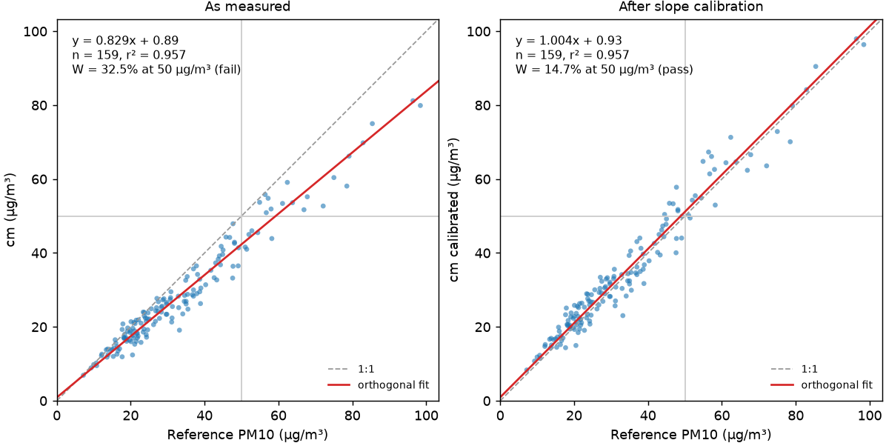
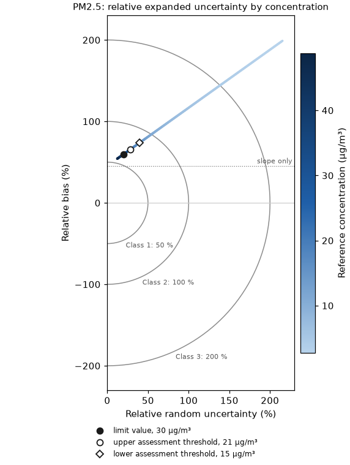

# aqequiv

Equivalence testing and sensor classification for ambient air quality
measurements, in Python.

`aqequiv` does three related jobs:

- **Equivalence of a candidate method** (`evaluate_pm`): the particulate
  matter procedure of the European Commission's *Guide to the Demonstration
  of Equivalence of Ambient Air Monitoring Methods* (January 2010). It tells
  you whether an automatic analyser meets the 25 % data quality objective
  against the reference method.
- **Classification of sensor systems** (`evaluate_sensor`): the field-test
  evaluation of CEN/TS 17660-2:2024 for PM and of CEN/TS 17660-1:2021 for
  gases. It tells you whether a low-cost sensor system reaches Class 1
  (indicative measurements), Class 2 (objective estimation) or Class 3
  (non-regulatory use).
- **Ongoing verification** (`verify_ongoing`): the yearly check of
  EN 16450:2017 that an equivalent PM instrument still meets the objective,
  and how many sites need comparisons next year.

These calculations are usually done in a spreadsheet. This package makes
them scriptable, testable and repeatable.



## Install

```bash
pip install git+https://github.com/pboric/aqequiv
```

Requires Python 3.10 or newer, with numpy, pandas and matplotlib.

## Equivalence of a candidate method

```python
import pandas as pd
import aqequiv as aq

data = pd.read_csv("campaigns.csv")   # one row per 24-hour period

result = aq.evaluate_pm(
    data,
    reference=["ref_1", "ref_2"],     # one or two reference samplers
    candidate=["cand_1", "cand_2"],   # one or two candidate instruments
    pollutant="PM10",                 # or "PM2.5"
    site="campaign",                  # optional: column naming each comparison
)

print(result)            # full text report
result.comparisons       # regression and uncertainty per candidate and dataset
result.between_sampler   # between-sampler uncertainties
result.dataset_checks    # is the dataset large and varied enough?
result.passed            # True if every uncertainty criterion is met
result.plot()            # scatter plot per candidate
```

If the slope or intercept is significant, calibrate and test again:

```python
calibrated = aq.evaluate_pm(data, ["ref_1", "ref_2"], ["cand_1", "cand_2"],
                            "PM10", site="campaign", calibration="auto")
calibrated.calibration                 # e.g. y_cal = (y - 1.204) / 0.871
calibrated.calibration.apply(values)   # apply it to new data
```

To try it without your own data, load one of the Guide's examples:

```python
data = aq.load_example("pm10_locC_cm2")
print(aq.evaluate_pm(data, "rm", "cm", "PM10", u_ref=1.5, calibration="auto"))
```

### What it calculates

| Step | Guide | Criterion |
|---|---|---|
| Between-sampler uncertainty of the reference method | eq. 9.4 | ≤ 2.0 µg/m³ |
| Between-sampler uncertainty of the candidate: all data, and above and below the split concentration | eq. 9.4 | ≤ 2.5 µg/m³ |
| Orthogonal regression of each candidate against the reference | Annex B | slope and intercept tested against 1 and 0 |
| Expanded relative uncertainty at the limit value: full dataset, high-concentration subset (if ≥ 40 pairs), each site | eq. 9.6–9.9 | ≤ 25 % |
| Calibration by intercept, slope or both, with the added uncertainty | eq. 9.10–9.19 | re-tested as above |
| Dataset suitability: share of results above the upper assessment threshold, number of comparisons, pairs per comparison | 9.4.2, 9.5.2 | ≥ 20 %, ≥ 4, ≥ 40 |

| | PM10 | PM2.5 |
|---|---|---|
| Concentration at which the uncertainty is evaluated | 50 µg/m³ | 30 µg/m³ |
| Split between low and high concentrations | 30 µg/m³ | 18 µg/m³ |
| Upper assessment threshold | 28 µg/m³ | 17 µg/m³ |

These are the values of the 2010 Guide. Pass your own `PMCriteria` to
`evaluate_pm` to change them.

The building blocks are available on their own: `orthogonal_regression`,
`between_sampler_uncertainty` and `comparability`.

### EN 16450

EN 16450:2017 uses the same field-test evaluation as the Guide with three
differences, switched on with `standard="en16450"`:

- a single reference sampler is given an uncertainty of 0.67 µg/m³ (the
  Guide's default is a variance of 0.67, so an uncertainty of 0.82 µg/m³);
- with `calibration="auto"`, no calibration is made for a slope between
  0.98 and 1.02 or an intercept within ±1 µg/m³, even if significant;
- 32 reference results above the threshold are enough when they make up
  less than 20 % of the dataset.

### Ongoing verification

```python
check = aq.verify_ongoing(
    parallel,                      # parallel measurements of the last 3 years
    reference="rm", candidate="ams", pollutant="PM10",
    site="site", period="year",
    applied_calibration="slope",   # if the instrument is slope-corrected in routine use
    n_network_sites=30,            # sites operating this instrument type
)
print(check)
check.w_pct             # expanded uncertainty of the full dataset, %
check.sites_required    # sites to compare next year; None if action is needed
check.action_required   # True if the uncertainty is above the objective
check.pairs             # valid pairs per site and year (at least 80 required)
```

| Expanded uncertainty | ≤ 10 % | ≤ 15 % | ≤ 20 % | ≤ 25 % |
|---|---|---|---|---|
| Share of sites | 10 % | 10 % | 15 % | 20 % |
| Number of sites | 2 | 3 | 4 | 5 |

The smaller of the two applies, with a minimum of two sites.

## Classification of a sensor system

```python
result = aq.evaluate_sensor(
    daily,                               # one row per day, both seasons
    reference="ref",                     # reference method, 24-hour values
    sensors=["s1", "s2", "s3"],          # three replicate sensor systems
    pollutant="PM2.5",                   # or "PM10"
    site="site",                         # every site is evaluated separately
    u_ref=0.67,                          # reference between-sampler uncertainty
    rh_factor={"A": 1.37, "B": 1.27},    # from aq.rh_factor, per site
)

print(result)            # full text report
result.sensor_class      # 1, 2, 3 or None
result.datasets          # slope, intercept, uncertainty and class per site and sensor
result.between_sensor    # between-sensor-system uncertainty per site
result.plot()            # one panel per site and sensor system
result.target_diagram()  # Modified Target Diagram per site and sensor system
```

The class is the worst one over all sites, sensor systems and criteria. The
`limited_by` column shows which criterion holds each dataset back.

A single slope and/or intercept correction for all systems and sites can be
applied with `correction="slope"`, `"intercept"` or `"both"`; its
uncertainty is added to the result.

Helpers for the inputs:

| Function | Purpose |
|---|---|
| `daily_means(hourly, min_coverage)` | 24-hour averages, valid only with enough hourly values (0.90 for Class 1, 0.50 for Class 2) |
| `rh_factor(sensor, equivalent, rh)` | Humidity test: median sensor-to-equivalent ratio at 85–95 % RH over that at 30–60 % RH, from hourly data |
| `coarse_test(...)` | PM10 only: does the sensor's PM10-2.5 follow the reference method's? |
| `fine_coarse_factor(...)` | PM10 only: laboratory factor from the fine and coarse chamber tests |
| `between_sensor_uncertainty(values)` | Between-sensor-system uncertainty of replicate systems |
| `field_uncertainty(x, y)` | Regression and expanded uncertainty for one dataset |

### What it checks

| Criterion | Class 1 | Class 2 | Class 3 |
|---|---|---|---|
| Expanded uncertainty at the limit value, PM10 (50 µg/m³) | ≤ 25 µg/m³ | ≤ 50 µg/m³ | ≤ 100 µg/m³ |
| Expanded uncertainty at the limit value, PM2.5 (30 µg/m³) | ≤ 15 µg/m³ | ≤ 30 µg/m³ | ≤ 60 µg/m³ |
| Between-sensor-system uncertainty | ≤ 3 µg/m³ | ≤ 5 µg/m³ | ≤ 7 µg/m³ |
| Data capture of 24-hour averages | ≥ 90 % | ≥ 50 % | – |
| Slope of the regression line | 0.78–1.29 | 0.60–1.67 | 0.43–2.33 |
| Intercept of the regression line | ±3 µg/m³ | ±5 µg/m³ | ±7 µg/m³ |
| Humidity factor | < 1.5 | < 2.5 | – |
| PM10: coarse fraction in the field (slope 0.5–2, R² > 0.5) and in the laboratory (factor < 2) | required | – | – |

The expanded uncertainty is also reported at the upper and lower assessment
thresholds. The regression is ordinary least squares, as the specification
prescribes for sensors. Pass your own `SensorCriteria` to change a limit.

To report hourly performance against an equivalent method, call
`field_uncertainty` with hourly data; hourly results do not count towards
the class.

### Gas sensors

The same function classifies gas sensor systems from hourly field data:

```python
result = aq.evaluate_sensor(hourly, "ref", ["s1", "s2", "s3"], "NO2",
                            site="site", u_ref=1.2)
```

| | NO2 | NO | O3 | SO2 | CO (mg/m³) | Benzene |
|---|---|---|---|---|---|---|
| Level of evaluation | 200 | 200 | 120 | 350 | 10 | 5 |
| Class 1 / 2 / 3 uncertainty | 50 / 150 / 400 | 50 / 150 / 400 | 36 / 90 / 240 | 88 / 263 / 700 | 2.5 / 7.5 / 20 | 1.5 / 5 / 10 |
| Between-sensor uncertainty | 7.6 / 15 / 31 | 5 / 10 / 20 | 8 / 12 / 24 | 10.6 / 21 / 43 | 0.058 / 0.116 / 0.232 | 1.3 / 2.6 / 5.2 |
| Intercept (±) | 9.8 / 19 / 33 | 6.4 / 12 / 22 | 9.8 / 19 / 33 | 1.4 / 2.5 / 4.5 | 0.18 / 0.25 / 0.40 | 0.28 / 0.58 / 0.60 |

Values are in µg/m³ unless noted. Slope and data-capture requirements are
the same as for PM, and there is no humidity or coarse-fraction test.

- `u_ref`, the between-instrument uncertainty of the reference analyser, has
  no default: take it from the analyser's type-approval report, in the unit
  of your data.
- Only the field test is evaluated. The specification also requires a
  pre-test (response time, lack of fit, repeatability) and, depending on the
  route, laboratory tests; the final class is the lowest of all of them.
- The check for interferents that correlate with the pollutant at the test
  site is left to you.

### Modified Target Diagram



`result.target_diagram()`, or `aq.target_diagram(x, y, "PM2.5")` for a
single dataset, draws the diagram of Yatkin et al. (2022). It splits the
relative expanded uncertainty into a random part (horizontal) and a bias
part (vertical) along the range of reference concentrations. The distance of
a point from the centre is the relative expanded uncertainty at that
concentration, and the circles are the class limits. A curve that sits high
or low is dominated by bias, which a correction can remove; a curve far to
the right is dominated by scatter, which it cannot.

Two options of the paper are not implemented: residuals fitted as a function
of concentration, and adding the between-sensor uncertainty to the random
part.

## Command line and HTML report

Installing the package also installs the `aqequiv` command, so the
evaluations can be run on a CSV file without writing Python:

```console
$ aqequiv pm parallel.csv --reference ref_1 ref_2 --candidate cand \
      --pollutant PM10 --site site --calibration auto --html report.html
$ aqequiv sensor daily.csv --reference ref --sensors s1 s2 s3 \
      --pollutant PM2.5 --site site --rh-factor 1.3 --html report.html
$ aqequiv ongoing parallel.csv --reference rm --candidate ams \
      --site site --period year --network-sites 30
$ aqequiv example pm25_locA_cm1 -o example.csv    # a dataset to try it on
```

Each command prints the text report. The options mirror the arguments of
the Python functions; `aqequiv pm --help` lists them. In addition:

- `--html FILE` writes the report as one self-contained HTML page with the
  verdict, all tables and the figures. It needs no internet connection and
  prints well. From Python: `result.to_html("report.html")`.
- `--plot FILE` saves the scatter plot, and `--target-diagram FILE` the
  Modified Target Diagram of a sensor test.
- `--objectives 2030` uses the objectives of Directive (EU) 2024/2881.
- `--check` makes the exit status 1 when the criteria are not met (for
  sensors: when the class is worse than `--required-class`), so the command
  can be used in scripts. Status 2 means the input could not be evaluated.
- The column separator and the decimal mark are detected, so files exported
  with `;` and a decimal comma work as they are. `--sep` and `--decimal`
  override the detection.

## Directive (EU) 2024/2881

The new air quality directive sets its own data quality objectives and, from
2030, lower limit values. They are available as ready-made criteria:

```python
aq.evaluate_pm(data, ["ref_1", "ref_2"], "cand", criteria=aq.PM10_2030)
aq.evaluate_sensor(daily, "ref", ["s1", "s2", "s3"], site="site",
                   criteria=aq.SENSOR_PM25_2030)
```

| | PM10 | PM2.5 |
|---|---|---|
| 24-hour limit value from 2030 | 45 µg/m³ | 25 µg/m³ |
| Fixed measurements: maximum uncertainty | 11.3 µg/m³ or 25 % | 6.3 µg/m³ or 25 % |
| Indicative measurements: maximum uncertainty | 22.5 µg/m³ or 50 % | 8.8 µg/m³ or 35 % |
| Objective estimation: ratio to indicative, capped at 85 % | 2.2 | 2.5 |

Where the directive gives an absolute and a relative value, the higher one
applies. The values are from Annex I and Annex V of the directive.

These criteria are an interpretation, not an official procedure. Neither the
2010 Guide nor CEN/TS 17660-2 has been revised for the new directive:

- `PM10_2030` and `PM25_2030` evaluate the uncertainty at the 2030 limit
  value against the objective for fixed measurements. The concentration
  split and the threshold for the dataset remain those of the 2010 Guide.
- `SENSOR_PM10_2030` and `SENSOR_PM25_2030` set Class 1 to the objective for
  indicative measurements, Class 2 to the one for objective estimation
  (38.25 and 21.25 µg/m³), and Class 3 to 200 % of the limit value as in the
  specification. Slope, intercept and the other requirements are unchanged.
  The directive has no 24-hour assessment thresholds for PM, so the
  uncertainty is reported at the limit value only.

## Validation

**Sensor classification.** CEN/TS 17660-2 contains no worked numerical
example, so the tests check each formula against an independent calculation
and the classification logic against constructed cases. CEN/TS 17660-1
prints summary statistics of an NO2 example (Annex K) but not its data; the
tests reproduce its uncertainties at four concentration levels from the
printed regression results, to within the rounding of the printed slope.

**EN 16450.** The standard has no worked example; its rules are tested on
constructed cases.

**Equivalence.** The test suite reproduces the five worked examples in Annex F of the Guide
(PM2.5 and PM10, before and after calibration) to the precision the Guide
prints. The example data ship with the package.

Two things to know when comparing with the Guide:

- **Reference uncertainty.** Clause 9.5.3.2 says the uncertainty of the
  reference results may be taken as the reference between-sampler
  uncertainty divided by √2. The Annex F examples use the between-sampler
  uncertainty itself. `aqequiv` follows the clause by default; pass `u_ref`
  to choose another value.
- **Printed uncertainty.** Annex F prints the combined relative uncertainty.
  `aqequiv` reports the expanded one (`W_pct`, coverage factor 2), which is
  the number compared with the 25 % objective.

## Limitations

- Field data only. The laboratory parts of the documents are not covered:
  type testing in EN 16450, and the pre-test and laboratory tests for gas
  sensors in CEN/TS 17660-1.
- `evaluate_sensor` covers the calculations, not the test design. It does
  not check site types, seasons, climate, or that enough high-concentration
  days were sampled; the visual check for linearity and for PM10 being
  derived from PM2.5 is left to you (use `result.plot()`).
- Outliers are not removed for you. The Guide allows removing up to 2.5 %
  of data pairs; do that before calling `evaluate_pm`.
- Calibration through the origin (eq. 9.11a–9.15a) is not wired into
  `evaluate_pm`; `orthogonal_regression(..., through_origin=True)` gives the
  fit.
- This is an independent implementation, not an official tool, and it does
  not replace the documents it implements. Check the results before using
  them in a formal report.

## Development

```bash
uv sync
uv run pytest
uv run python examples/guide_example.py    # regenerates docs/example.png
uv run python examples/sensor_example.py   # regenerates docs/target_diagram.png
```

## References

- EC Working Group on Guidance for the Demonstration of Equivalence. *Guide
  to the Demonstration of Equivalence of Ambient Air Monitoring Methods.*
  January 2010.
- EN 16450:2017. *Ambient air – Automated measuring systems for the
  measurement of the concentration of particulate matter (PM10; PM2,5).*
- CEN/TS 17660-1:2021. *Air quality – Performance evaluation of air quality
  sensor systems – Part 1: Gaseous pollutants in ambient air.*
- CEN/TS 17660-2:2024. *Air quality – Performance evaluation of air quality
  sensor systems – Part 2: Particulate matter in ambient air.*
- Directive (EU) 2024/2881 of the European Parliament and of the Council of
  23 October 2024 on ambient air quality and cleaner air for Europe.
- Yatkin, S., Gerboles, M., Borowiak, A., et al. (2022). Modified Target
  Diagram to check compliance of low-cost sensors with the Data Quality
  Objectives of the European air quality directive. *Atmospheric
  Environment*, 273, 118967. https://doi.org/10.1016/j.atmosenv.2022.118967

## Licence

MIT
