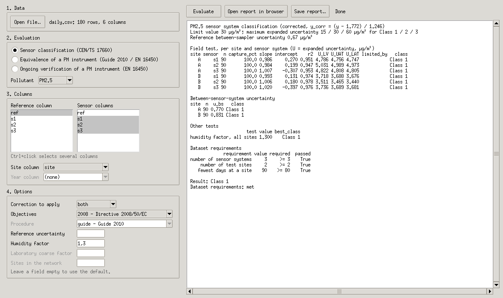

# aqequiv user manual

Hrvatska verzija: [upute.md](upute.md)

This manual is for people who want to run the evaluations without writing
code. It covers the desktop application; the Python functions and the
command line are described in the [README](../README.md).

## 1. What the program does

You give it a table of parallel measurements: a reference method and the
instruments you are testing, side by side. It returns a report with the
verdict, the numbers behind it and the figures.

| Evaluation | Question it answers | Document it follows |
|---|---|---|
| Sensor classification | Does a sensor system reach Class 1 (indicative measurements), Class 2 (objective estimation) or Class 3? | CEN/TS 17660-2 (PM), CEN/TS 17660-1 (gases) |
| Equivalence of a PM instrument | Does an automatic PM instrument meet the 25 % uncertainty objective against the reference method? | Guide to the Demonstration of Equivalence (2010), EN 16450 |
| Ongoing verification | Does an instrument already declared equivalent still meet the objective, and at how many sites must it be compared next year? | EN 16450, clause 8.6 |

The program works on your computer only. It does not send your data
anywhere and needs no internet connection.

## 2. Getting the program

### Windows

1. Open the [Releases page](https://github.com/pboric/aqequiv/releases) and
   download `aqequiv.exe`.
2. Double-click it. Nothing is installed; the file is the whole program and
   can be kept on a USB stick or a shared folder.

- Starting takes several seconds, because the program unpacks itself each time.
- Windows may show "Windows protected your PC", because the file is not
  signed by a publisher. Choose **More info**, then **Run anyway**. If your
  organisation blocks unsigned programs, ask IT to allow the file, or use
  the Python route below.

### Any system with Python

```
pip install "aqequiv[excel] @ git+https://github.com/pboric/aqequiv"
aqequiv-app
```

## 3. Preparing the data

One row per averaging period, one column per instrument:

| date | site | ref | s1 | s2 | s3 |
|---|---|---|---|---|---|
| 2025-01-10 | A | 18.4 | 24.9 | 23.7 | 25.6 |
| 2025-01-11 | A | 31.0 | 40.2 | 41.5 | 39.8 |
| 2025-01-12 | A | 12.7 | | 17.1 | 16.9 |

- **File type.** CSV or Excel (`.xlsx`; the first sheet is read). In CSV
  files both `;` with a decimal comma and `,` with a decimal point work.
- **First row.** Column names. Any names will do; you pick the columns in
  the program.
- **Averaging period.** 24-hour values for PM, hourly values for gases. The
  reference and the instruments must cover the same period: if the
  reference filter runs from noon to noon, average the instruments from
  noon to noon as well.
- **Units.** µg/m³; CO in mg/m³.
- **Missing values.** Leave the cell empty. Do not fill gaps and do not
  delete the row: for sensors, the days on which the reference has a value
  and the sensor does not count against data capture.
- **Site column** (optional). The name of the site or campaign in every
  row. Each site is evaluated separately.
- **Year column** (ongoing verification only). The year of each row.
- **Columns with text** in place of numbers (for example `<2` or `n/a`) do
  not appear in the column lists. Clean those cells first.

If your table has one row per instrument and day (a "long" table with an
instrument-name column), turn it into the layout above first, for example
with a pivot table in Excel.

## 4. Using the window



1. **Open file…** The first rows appear on the right so you can check that
   the file was read correctly.
2. **Evaluation** and **Pollutant.** Choose one of the three evaluations.
   The fields that do not apply to it turn grey.
3. **Columns.** Click the reference column in the left list and the
   instruments under test in the right list. Hold Ctrl to select several.
   Choose the site column if you have one.
4. **Options.** See the next section. Empty fields use the default.
5. **Evaluate.** The text report appears on the right.
6. **Open report in browser** shows the full report with figures.
   **Save report…** stores it as one `.html` file, which you can e-mail,
   archive or print to PDF from the browser.

## 5. The options, by evaluation

### Sensor classification

| Field | Meaning |
|---|---|
| Reference column | One column with the reference method. |
| Sensor columns | The replicate sensor systems; the specification asks for three. |
| Correction to apply | `none` evaluates the sensor as it is. `intercept`, `slope` or `both` first corrects all sensors with one common regression line; the uncertainty of that correction is added to the result. |
| Objectives | `2008` uses the limits of the specification. `2030` uses limits derived from Directive (EU) 2024/2881; that mapping is the author's interpretation, not part of the specification. PM only. |
| Reference uncertainty | Between-sampler uncertainty of the reference method. PM: empty means 0.67 µg/m³. Gases: required; take it from the analyser's type-approval report. |
| Humidity factor | PM only. Result of the humidity test, which needs hourly data from an equivalent method and is calculated with the Python function `rh_factor`. Leave empty if you do not have it; the class is then marked provisional. |
| Laboratory coarse factor | PM10 only, from the laboratory test with coarse particles. |

What a complete field test needs: three sensor systems, two sites, and two
campaigns of at least 40 days at each site (for gases, at least 1920 hours
per site). With less, the program still calculates, and states under
"Dataset requirements" what is missing.

### Equivalence of a PM instrument

| Field | Meaning |
|---|---|
| Reference column(s) | One or two reference samplers. With two, their mean is used and their between-sampler uncertainty is checked. |
| Candidate column(s) | One or two instruments of the type under test. With two, the between-instrument uncertainty is checked. |
| Calibration to apply | `none` tests the data as they are. `auto` calibrates by intercept, slope or both when the regression shows it is needed, and tests again. |
| Procedure | `guide` follows the 2010 Guide; `en16450` follows EN 16450:2017, which differs in the default reference uncertainty and in when a calibration is required. |
| Reference uncertainty | Empty uses the default of the chosen procedure. |

A full test needs at least four comparisons (sites or seasons) of at least
40 days each, with at least 20 % of the reference results above the upper
assessment threshold (28 µg/m³ for PM10, 17 µg/m³ for PM2.5).

### Ongoing verification

| Field | Meaning |
|---|---|
| Year column | Used to check that every site has at least 80 valid pairs a year. |
| Calibration already applied | The calibration used in routine operation, if the values in the file are already calibrated. |
| Sites in the network | Number of sites that operate this instrument type; it determines how many sites must be compared next year. |

Give the program the parallel measurements of the last three years.

## 6. Reading the report

**The tiles at the top** give the verdict. Green means the criteria are
met, red that they are not, and yellow that the result comes with a
condition: a provisional class, or a dataset smaller than the document
asks for.

**"Provisional"** means the class depends on a test you did not supply.
For example, Class 1 and Class 2 for PM require the humidity test.

**Main table, one row per instrument and dataset:**

| Column | Meaning |
|---|---|
| n | Number of valid pairs. |
| slope, intercept | The regression line of the instrument against the reference. A perfect instrument has slope 1 and intercept 0. |
| R² | How closely the points follow the line. |
| random term | The scatter around the line, after removing the share explained by the reference method's own uncertainty. |
| bias | The systematic difference at the limit value: intercept + (slope − 1) × limit value. |
| u<sub>c</sub> | Combined uncertainty at the limit value. |
| W, % | Expanded relative uncertainty at the limit value (coverage factor 2). This is the number compared with 25 %. |
| U at LV, UAT, LAT | Sensors: expanded uncertainty in µg/m³ at the limit value and at the upper and lower assessment thresholds. |
| data capture, % | Sensors: share of periods with a valid sensor value. |
| limited by | Sensors: the criterion that holds this dataset back from a better class. |
| class / result | Outcome for this row. |

**Between-sampler / between-sensor uncertainty** shows how well identical
instruments agree with each other (u<sub>bs</sub>).

**Dataset requirements** lists whether the test is large enough. A result
can meet the uncertainty criteria on a dataset that is too small; the
report shows both so you can tell them apart.

**Scatter plots.** Each point is one day (or hour). The dashed line is 1:1,
the red line the regression, the grey vertical line the limit value.

**Modified Target Diagram** (sensors). The distance of the curve from the
centre is the relative expanded uncertainty at each concentration; the
circles are the class limits. A curve that lies high or low is dominated by
bias, which a correction can remove. A curve far to the right is dominated
by scatter, which a correction cannot remove.

## 7. Common questions

**My column is not in the list.** It contains text in some cells, or the
decimal mark was not recognised. Open the file, check the column, and
look at the preview after opening it in the program.

**"give u_ref…"** For gases the program needs the uncertainty of the
reference analyser. Type it into "Reference uncertainty".

**The result differs from my spreadsheet.** The usual reasons:
- The Guide prescribes orthogonal regression. Ordinary least squares, or
  Deming regression with a variance ratio other than 1, gives a different
  slope and therefore a different uncertainty.
- The reference uncertainty. The Guide's default is a variance of 0.67
  (uncertainty 0.82 µg/m³); EN 16450 and CEN/TS 17660 use an uncertainty of
  0.67 µg/m³.
- The limit value for PM2.5 in the Guide's test is 30 µg/m³.
- The report gives the expanded uncertainty W; some sources print the
  combined uncertainty w, which is half of it.

**"Dataset requirements: not met".** The calculation is valid for your
data, but the test is smaller than the document asks for (for example one
site instead of two). Say so when you report the result.

**Can I evaluate a sensor that was corrected with my own model?** Yes. Put
the corrected values in the sensor columns and choose correction `none`.
Correct each day with a model that was not fitted on that day, otherwise
the uncertainty comes out too low.

## 8. What the program does not do

- It evaluates field data only. Laboratory tests (type testing of
  instruments, pre-test and laboratory tests of gas sensors) are not
  covered.
- It does not replace the standards. To use the results formally you need
  the documents themselves.
- The report is a calculation, not a test report of an accredited
  laboratory.
