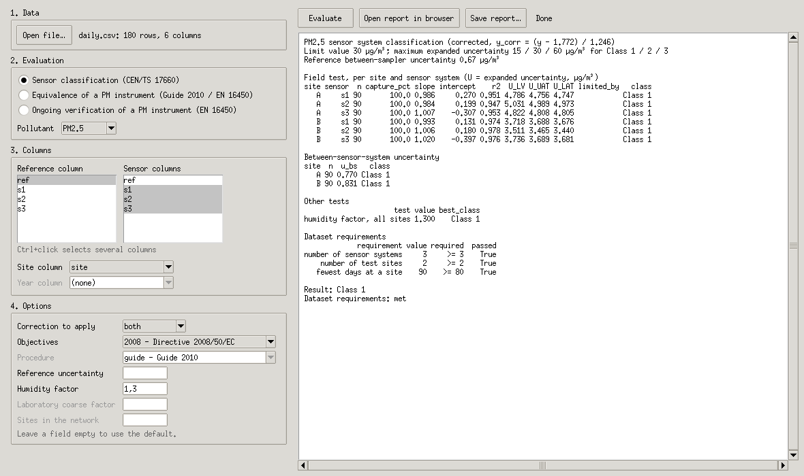

# aqequiv – upute za korištenje

English version: [manual.md](manual.md)

Upute su namijenjene onima koji žele provesti proračun bez pisanja koda.
Opisuju aplikaciju s prozorom; Python funkcije i naredbeni redak opisani su
u datoteci [README](../README.md). Nazivi polja u programu su na engleskom,
pa su ovdje navedeni u izvornom obliku, **podebljano**.

## 1. Što program radi

Programu se zada tablica usporednih mjerenja: referentna metoda i uređaji
koji se ispituju, jedni uz druge. Program vraća izvješće s ocjenom,
brojkama na kojima se ocjena temelji i slikama.

| Proračun | Na koje pitanje odgovara | Dokument koji slijedi |
|---|---|---|
| Klasifikacija senzora (**Sensor classification**) | Doseže li senzorski sustav klasu 1 (indikativna mjerenja), klasu 2 (objektivna procjena) ili klasu 3? | CEN/TS 17660-2 (lebdeće čestice), CEN/TS 17660-1 (plinovi) |
| Ekvivalentnost PM uređaja (**Equivalence of a PM instrument**) | Zadovoljava li automatski uređaj za PM cilj od 25 % mjerne nesigurnosti prema referentnoj metodi? | Vodič za dokazivanje ekvivalentnosti (2010.), EN 16450 |
| Trajna provjera (**Ongoing verification**) | Zadovoljava li uređaj koji je već proglašen ekvivalentnim i dalje taj cilj, i na koliko ga postaja treba uspoređivati iduće godine? | EN 16450, točka 8.6 |

Program radi samo na vašem računalu. Podatke nikamo ne šalje i ne treba
internetsku vezu.

## 2. Kako doći do programa

### Windows

1. Otvorite [stranicu Releases](https://github.com/pboric/aqequiv/releases)
   i preuzmite `aqequiv.exe`.
2. Dvaput kliknite na datoteku. Ništa se ne instalira; ta datoteka je cijeli
   program i može stajati na USB-u ili u zajedničkoj mapi.

- Pokretanje traje nekoliko sekundi jer se program svaki put raspakirava.
- Windows može prikazati poruku „Windows protected your PC" jer datoteka
  nema potpis izdavača. Odaberite **More info**, zatim **Run anyway**. Ako
  vaša ustanova blokira nepotpisane programe, zamolite informatičku službu
  da dopusti datoteku ili koristite put preko Pythona.

### Bilo koji sustav s Pythonom

```
pip install "aqequiv[excel] @ git+https://github.com/pboric/aqequiv"
aqequiv-app
```

## 3. Priprema podataka

Jedan red po razdoblju usrednjavanja, jedan stupac po uređaju:

| date | site | ref | s1 | s2 | s3 |
|---|---|---|---|---|---|
| 2025-01-10 | A | 18,4 | 24,9 | 23,7 | 25,6 |
| 2025-01-11 | A | 31,0 | 40,2 | 41,5 | 39,8 |
| 2025-01-12 | A | 12,7 | | 17,1 | 16,9 |

- **Vrsta datoteke.** CSV ili Excel (`.xlsx`; čita se prvi list). U CSV-u
  rade i `;` s decimalnim zarezom i `,` s decimalnom točkom.
- **Prvi red.** Nazivi stupaca. Mogu biti bilo kakvi; stupce birate u
  programu.
- **Razdoblje usrednjavanja.** 24-satne vrijednosti za PM, satne za
  plinove. Referenca i uređaji moraju pokrivati isto razdoblje: ako
  referentni filtar traje od podneva do podneva, i uređaje usrednjite od
  podneva do podneva.
- **Jedinice.** µg/m³; CO u mg/m³.
- **Podaci koji nedostaju.** Ostavite praznu ćeliju. Ne popunjavajte
  praznine i ne brišite red: kod senzora se dani u kojima referenca ima
  vrijednost, a senzor nema, računaju u obuhvat podataka.
- **Stupac postaje** (neobavezan). Naziv postaje ili kampanje u svakom
  redu. Svaka postaja se ocjenjuje zasebno.
- **Stupac godine** (samo za trajnu provjeru). Godina svakog reda.
- **Stupci s tekstom** umjesto brojeva (na primjer `<2` ili `n/a`) ne
  pojavljuju se u popisu stupaca. Takve ćelije prvo očistite.

Ako tablica ima jedan red po uređaju i danu („duga" tablica sa stupcem
naziva uređaja), prvo je pretvorite u gornji oblik, na primjer zaokretnom
tablicom u Excelu.

## 4. Rad u prozoru



1. **Open file…** Prvi redovi datoteke pojave se desno, da provjerite je li
   datoteka dobro pročitana.
2. **Evaluation** i **Pollutant.** Odaberite jedan od triju proračuna i
   onečišćujuću tvar. Polja koja se na taj proračun ne odnose posive.
3. **Columns.** U lijevom popisu kliknite referentni stupac, u desnom
   uređaje koji se ispituju. Za više stupaca držite Ctrl. Ako imate stupac
   postaje, odaberite ga pod **Site column**.
4. **Options.** Vidi sljedeće poglavlje. Prazno polje znači zadanu
   vrijednost.
5. **Evaluate.** Tekstualno izvješće pojavi se desno.
6. **Open report in browser** prikazuje puno izvješće sa slikama.
   **Save report…** sprema ga kao jednu `.html` datoteku koju možete
   poslati e-poštom, arhivirati ili iz preglednika ispisati u PDF.

## 5. Opcije po proračunu

### Klasifikacija senzora (Sensor classification)

| Polje | Značenje |
|---|---|
| **Reference column** | Jedan stupac s referentnom metodom. |
| **Sensor columns** | Istovrsni senzorski sustavi; specifikacija traži tri. |
| **Correction to apply** | `none` ocjenjuje senzor kakav jest. `intercept`, `slope` ili `both` prvo korigira sve senzore jednim zajedničkim regresijskim pravcem; nesigurnost te korekcije dodaje se rezultatu. |
| **Objectives** | `2008` koristi granice iz specifikacije. `2030` koristi granice izvedene iz Direktive (EU) 2024/2881; to preslikavanje je autorovo tumačenje, a ne dio specifikacije. Samo za PM. |
| **Reference uncertainty** | Nesigurnost između uzorkivača referentne metode. PM: prazno znači 0,67 µg/m³. Plinovi: obavezno; uzima se iz izvješća o tipnom odobrenju analizatora. |
| **Humidity factor** | Samo PM. Rezultat ispitivanja utjecaja vlage, za koje trebaju satni podaci ekvivalentne metode, a računa se Python funkcijom `rh_factor`. Ako ga nemate, ostavite prazno; klasa se tada označava kao privremena. |
| **Laboratory coarse factor** | Samo PM10, iz laboratorijskog ispitivanja s grubim česticama. |

Potpuno terensko ispitivanje traži tri senzorska sustava, dvije postaje i
na svakoj dvije kampanje od najmanje 40 dana (za plinove najmanje 1920
sati po postaji). S manje podataka program svejedno računa, a pod „Dataset
requirements" navodi što nedostaje.

### Ekvivalentnost PM uređaja (Equivalence of a PM instrument)

| Polje | Značenje |
|---|---|
| **Reference column(s)** | Jedan ili dva referentna uzorkivača. S dva se koristi njihova srednja vrijednost i provjerava nesigurnost između njih. |
| **Candidate column(s)** | Jedan ili dva uređaja tipa koji se ispituje. S dva se provjerava nesigurnost između uređaja. |
| **Calibration to apply** | `none` ispituje podatke kakvi jesu. `auto` kalibrira odsječkom, nagibom ili oboje kad regresija pokaže da je potrebno, i ponovno ispituje. |
| **Procedure** | `guide` slijedi Vodič iz 2010.; `en16450` slijedi EN 16450:2017, koja se razlikuje u zadanoj nesigurnosti reference i u tome kada je kalibracija potrebna. |
| **Reference uncertainty** | Prazno znači zadanu vrijednost odabranog postupka. |

Potpuno ispitivanje traži najmanje četiri usporedbe (postaje ili sezone) od
najmanje 40 dana, uz najmanje 20 % referentnih rezultata iznad gornjeg
praga procjene (28 µg/m³ za PM10, 17 µg/m³ za PM2,5).

### Trajna provjera (Ongoing verification)

| Polje | Značenje |
|---|---|
| **Year column** | Služi za provjeru ima li svaka postaja najmanje 80 valjanih parova godišnje. |
| **Calibration already applied** | Kalibracija koja se koristi u redovnom radu, ako su vrijednosti u datoteci već kalibrirane. |
| **Sites in the network** | Broj postaja na kojima radi taj tip uređaja; o njemu ovisi na koliko se postaja uređaj mora uspoređivati iduće godine. |

Programu dajte usporedna mjerenja zadnje tri godine.

## 6. Čitanje izvješća

**Pločice na vrhu** daju ocjenu. Zeleno znači da su kriteriji zadovoljeni,
crveno da nisu, a žuto da rezultat dolazi uz uvjet: privremena klasa ili
skup podataka manji od onoga koji dokument traži.

**„Provisional"** (privremeno) znači da klasa ovisi o ispitivanju koje
niste dostavili. Na primjer, klase 1 i 2 za PM traže ispitivanje utjecaja
vlage.

**Glavna tablica, jedan red po uređaju i skupu podataka:**

| Stupac | Značenje |
|---|---|
| n | Broj valjanih parova. |
| slope, intercept | Nagib i odsječak regresijskog pravca uređaja prema referenci. Savršen uređaj ima nagib 1 i odsječak 0. |
| R² | Koliko točke prate pravac. |
| random term | Rasipanje oko pravca, umanjeno za dio koji objašnjava nesigurnost same referentne metode. |
| bias | Sustavna razlika na graničnoj vrijednosti: odsječak + (nagib − 1) × granična vrijednost. |
| u<sub>c</sub> | Sastavljena nesigurnost na graničnoj vrijednosti. |
| W, % | Proširena relativna nesigurnost na graničnoj vrijednosti (faktor pokrivanja 2). To je broj koji se uspoređuje s 25 %. |
| U at LV, UAT, LAT | Senzori: proširena nesigurnost u µg/m³ na graničnoj vrijednosti te na gornjem i donjem pragu procjene. |
| data capture, % | Senzori: udio razdoblja s valjanom vrijednošću senzora. |
| limited by | Senzori: kriterij zbog kojeg taj skup ne doseže bolju klasu. |
| class / result | Ishod za taj red. |

**Between-sampler / between-sensor uncertainty** pokazuje koliko se
istovrsni uređaji slažu međusobno (u<sub>bs</sub>).

**Dataset requirements** navodi je li ispitivanje dovoljno veliko. Rezultat
može zadovoljiti kriterije nesigurnosti na premalom skupu podataka;
izvješće prikazuje oboje da se to dvoje razlikuje.

**Dijagrami raspršenja.** Svaka točka je jedan dan (ili sat). Isprekidana
crta je pravac 1:1, crvena crta regresija, siva okomita crta granična
vrijednost.

**Modified Target Diagram** (senzori). Udaljenost krivulje od središta je
relativna proširena nesigurnost pri pojedinoj koncentraciji; kružnice su
granice klasa. Krivulja koja leži visoko ili nisko znači da prevladava
sustavna pogreška, koju korekcija može ukloniti. Krivulja daleko udesno
znači da prevladava rasipanje, koje korekcija ne može ukloniti.

## 7. Česta pitanja

**Mog stupca nema u popisu.** U nekim ćelijama ima tekst ili decimalni
znak nije prepoznat. Otvorite datoteku, provjerite stupac i pogledajte
pregled koji program prikaže nakon otvaranja.

**„give u_ref…"** Za plinove program treba nesigurnost referentnog
analizatora. Upišite je u **Reference uncertainty**.

**Rezultat se razlikuje od mog proračuna u tablici.** Uobičajeni razlozi:
- Vodič propisuje ortogonalnu regresiju. Obična metoda najmanjih kvadrata
  ili Demingova regresija s omjerom varijanci različitim od 1 daje drugi
  nagib, a time i drugu nesigurnost.
- Nesigurnost reference. Zadana vrijednost u Vodiču je varijanca 0,67
  (nesigurnost 0,82 µg/m³); EN 16450 i CEN/TS 17660 koriste nesigurnost
  0,67 µg/m³.
- Granična vrijednost za PM2,5 u ispitivanju po Vodiču je 30 µg/m³.
- Izvješće daje proširenu nesigurnost W; neki izvori ispisuju sastavljenu
  nesigurnost w, koja je upola manja.

**„Dataset requirements: not met".** Proračun vrijedi za vaše podatke, ali
je ispitivanje manje od onoga koje dokument traži (na primjer jedna
postaja umjesto dvije). Navedite to kad izvještavate o rezultatu.

**Mogu li ocijeniti senzor korigiran vlastitim modelom?** Da. Korigirane
vrijednosti stavite u stupce senzora i odaberite korekciju `none`. Svaki
dan korigirajte modelom koji nije učen na tom danu, inače nesigurnost
ispadne premala.

## 8. Što program ne radi

- Ocjenjuje samo terenske podatke. Laboratorijska ispitivanja (tipno
  ispitivanje uređaja, predtest i laboratorijska ispitivanja plinskih
  senzora) nisu obuhvaćena.
- Ne zamjenjuje norme. Za formalnu uporabu rezultata potrebni su sami
  dokumenti.
- Izvješće je proračun, a ne ispitni izvještaj akreditiranog laboratorija.
